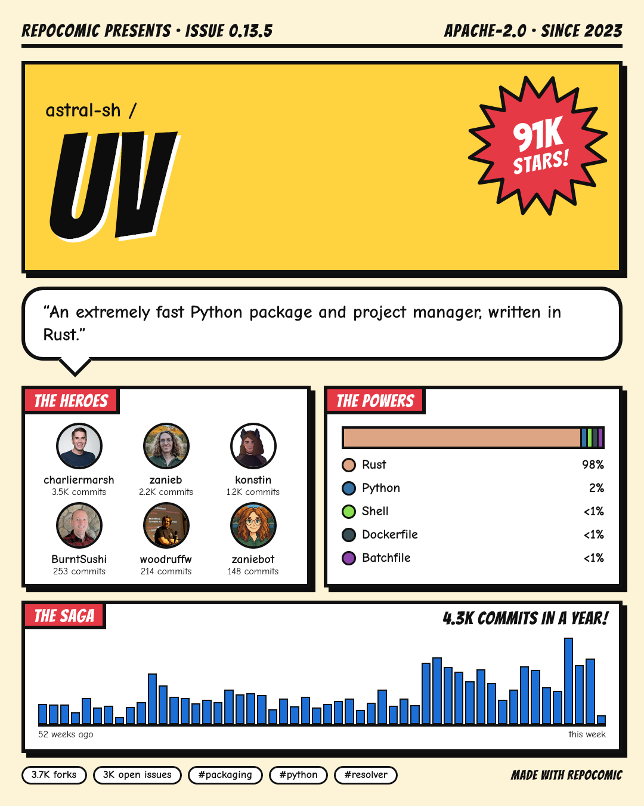
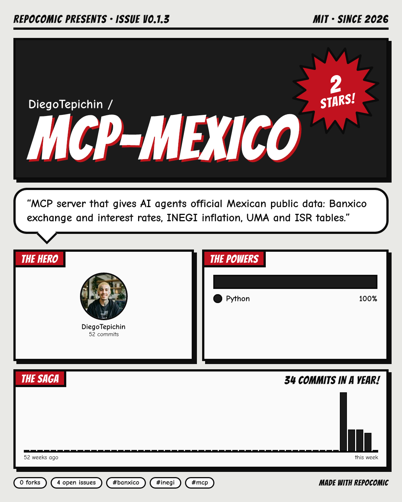
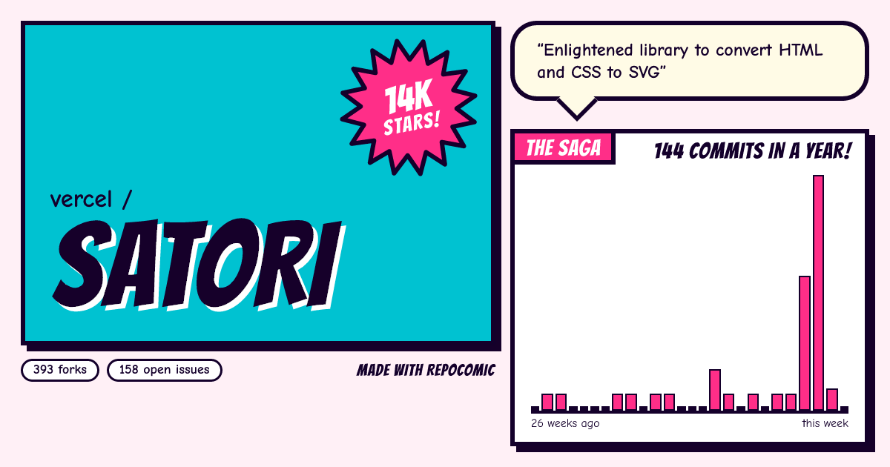
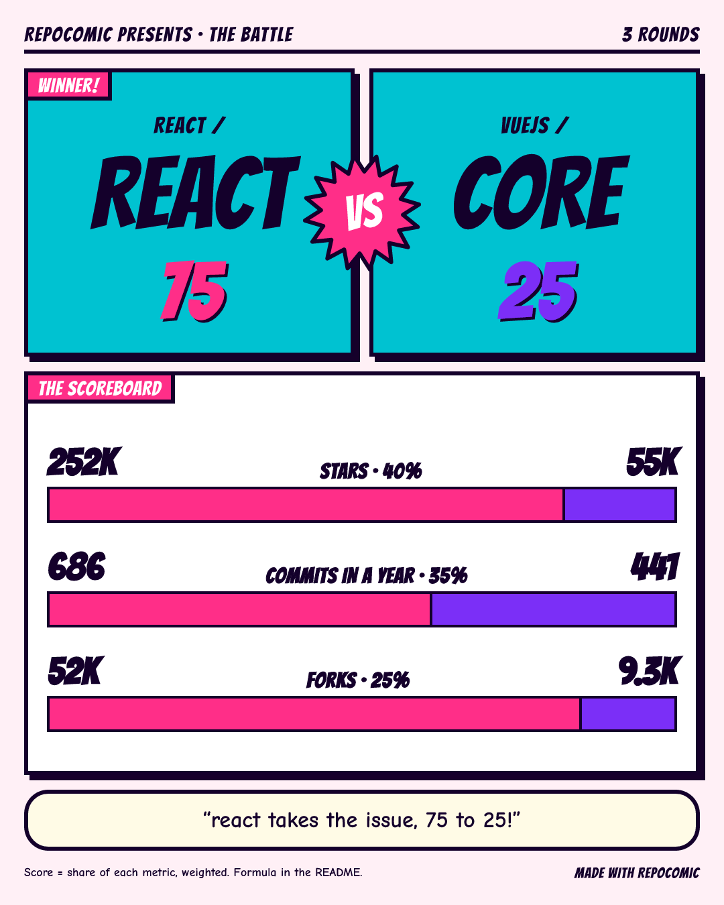

# repocomic

Convierte cualquier repositorio de GitHub en un póster estilo cómic que de verdad vas a querer compartir.

[](https://github.com/DiegoTepichin/repocomic/actions/workflows/ci.yml)
[](LICENSE)

[Read in English](README.md)

```bash
npx repocomic astral-sh/uv
```

<p>
  
  
</p>


*Generados por `repocomic` con datos reales de GitHub: `astral-sh/uv` (póster clásico), `DiegoTepichin/mcp-mexico` (`-t noir`) y `vercel/satori` (`-t pop -f card`).*

## Por qué

Los anuncios de releases y los encabezados de README suelen ser una captura de pantalla o nada. Las estadísticas de un repo son interesantes, pero una tabla de números no se comparte. `repocomic` las convierte en una portada de cómic: el nombre del repo sobre un fondo de semitonos, una explosión con las estrellas, la descripción en un globo de diálogo, los contribuidores como héroes, los lenguajes como poderes y un año de commits como la saga.

## Instalación

```bash
npx repocomic owner/repo            # sin instalar
npm install -g repocomic            # o instala el comando
```

Requiere Node.js 20 o superior. El render ocurre en tu máquina con [Satori](https://github.com/vercel/satori) y [resvg](https://github.com/yisibl/resvg-js); no hace falta un navegador.

## Uso

```bash
repocomic vercel/satori                                  # satori-poster.png
repocomic https://github.com/vercel/satori -t noir       # también acepta URLs de github.com
repocomic vercel/satori -f card -o og.png                # tarjeta social 1200x630
repocomic vercel/satori -o poster.svg                    # SVG en lugar de PNG
```

| Opción | Por defecto | Descripción |
|---|---|---|
| `-t, --theme <nombre>` | `classic` | `classic` (amarillo y rojo), `noir` (blanco y negro) o `pop` (cian y rosa). |
| `-f, --format <nombre>` | `poster` | `poster` mide 1080 × 1350 para Instagram y LinkedIn; `card`, 1200 × 630 para Open Graph y X. |
| `-o, --output <archivo>` | `<repo>-<formato>.png` | Termina en `.svg` para SVG; cualquier otra extensión da PNG. |
| `--save-json <archivo>` | | Guarda también las estadísticas descargadas. |
| `--from-json <archivo>` | | Renderiza estadísticas guardadas sin llamar a GitHub. |
| `--offline` | | No descarga avatares; los contribuidores aparecen con sus iniciales. |

### Límites de la API

Sin token, la API de GitHub permite 60 peticiones por hora (cada póster usa cinco). Con un [token personal](https://github.com/settings/tokens) sin permisos para repos públicos sube a 5,000:

```bash
export GITHUB_TOKEN=ghp_...          # GH_TOKEN también funciona
```

Un token con permiso `repo` también permite renderizar repositorios privados.

## Qué aparece en el póster

| Panel | Datos |
|---|---|
| Cabecera | Último release como número de edición, licencia y año de creación. |
| Portada | Dueño, nombre del repo y estrellas en una explosión (un repo sin estrellas todavía es un "NEW ARRIVAL!"). |
| Globo de diálogo | La descripción del repo. |
| The heroes | Hasta seis contribuidores principales con avatar y número de commits; los bots no aparecen. |
| The powers | Hasta cinco lenguajes por proporción de código, con los colores de GitHub. |
| The saga | Commits por semana del último año (la tarjeta muestra medio año). |
| Pie | Forks, issues abiertos y hasta tres temas. |

La tarjeta muestra la portada, el globo de diálogo y la saga.

## Batallas

```bash
repocomic battle facebook/react vuejs/core -t pop
```



`repocomic battle <repo-a> <repo-b>` escribe un póster versus de 1080 × 1350. Acepta `-t, --theme` y `-o, --output` igual que el comando de un solo repo; el archivo por defecto es `<a>-vs-<b>.png`.

### Cómo se calcula el puntaje

Cada métrica reparte el 100% entre los dos repos en proporción a sus valores. 800 estrellas contra 200 es una ronda 80/20; si ambos tienen cero, la ronda queda 50/50. El puntaje es la suma ponderada de esos repartos, redondeada a entero, así que los dos puntajes siempre suman 100.

| Ronda | Peso | Fuente |
|---|---|---|
| Estrellas | 40% | `stargazers_count` |
| Commits en un año | 35% | Suma de las últimas 52 semanas de actividad de commits de GitHub (0 mientras GitHub aún la calcula) |
| Forks | 25% | `forks_count` |

Gana el puntaje más alto; un empate de puntajes es empate. Los pesos son una elección, no una ley, y están en `src/battle.ts` por si no estás de acuerdo. La comparación es entre repositorios, no personas, y no dice nada sobre su calidad.

## Como librería

```ts
import { fetchRepoStats, renderPng } from "repocomic";
import { writeFile } from "node:fs/promises";

const stats = await fetchRepoStats("vercel/satori", { token: process.env.GITHUB_TOKEN });
await writeFile("satori.png", await renderPng(stats, { theme: "pop", format: "card" }));
```

`renderSvg` devuelve el SVG como texto. `fetchRepoStats` acepta un `fetch` propio; así corren los tests sin red.

## Desarrollo

```bash
npm ci
npm run lint && npm run typecheck && npm test
npm run build && node dist/bin.js vercel/satori
```

Los tests usan respuestas grabadas de la API de GitHub en `test/fixtures/`, nunca la red. Ver [CONTRIBUTING.md](CONTRIBUTING.md).

## Créditos

Fuentes: [Bangers](https://github.com/googlefonts/bangers) y [Comic Neue](https://github.com/crozynski/comicneue), ambas con licencia SIL Open Font License 1.1 (licencias en `assets/fonts/`).

## Licencia

[MIT](LICENSE) © Diego Tepichin
