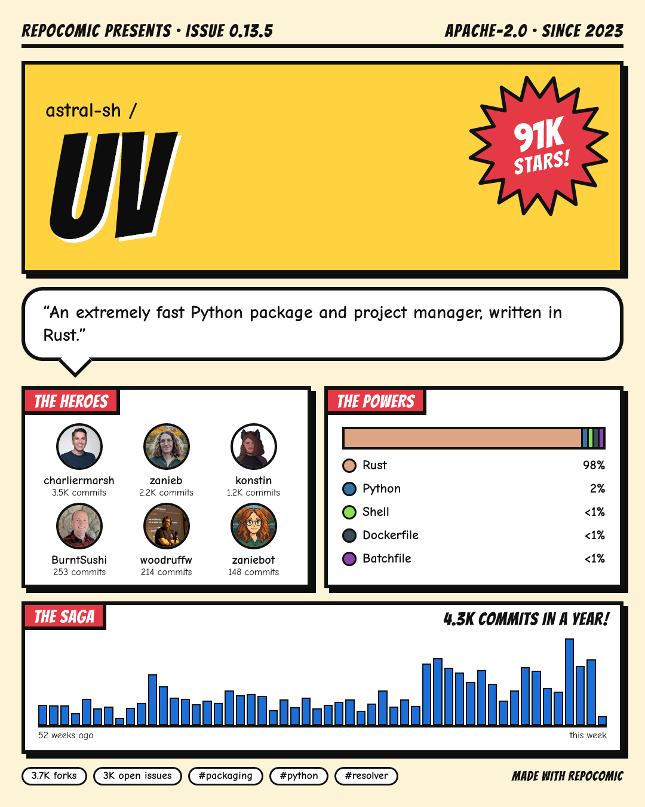
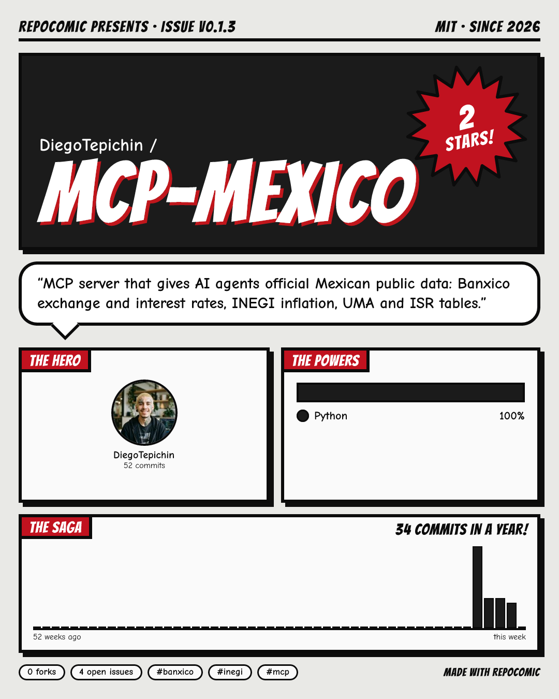
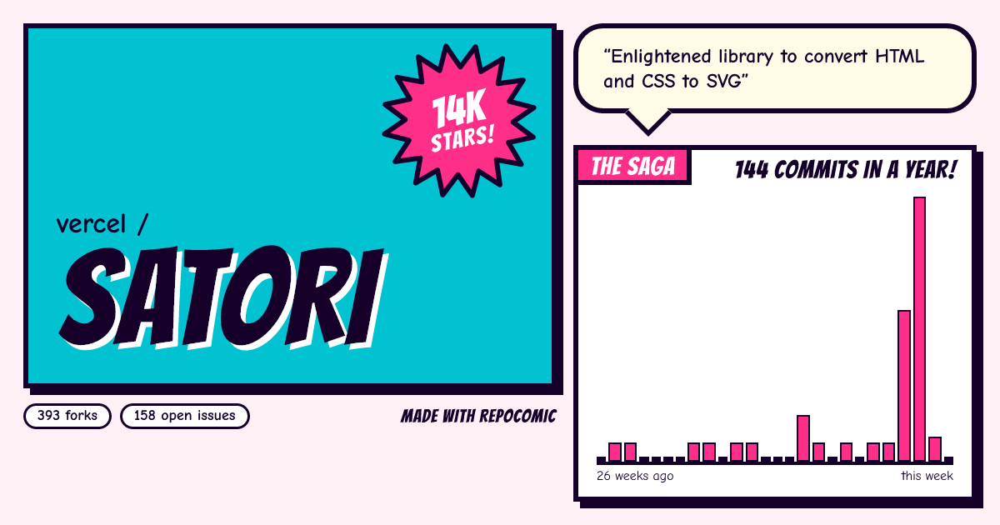

# repocomic

Turn any GitHub repository into a comic-book poster you will actually want to share.

[](https://github.com/DiegoTepichin/repocomic/actions/workflows/ci.yml)
[](LICENSE)

[Leer en español](README.es.md)

```bash
npx repocomic astral-sh/uv
```

<p>
  
  
</p>


*Generated by `repocomic` from live GitHub data: `astral-sh/uv` (classic poster), `DiegoTepichin/mcp-mexico` (`-t noir`), `vercel/satori` (`-t pop -f card`).*

## Why

Release announcements and README headers are usually a screenshot or nothing. Repository stats are interesting, but a table of numbers does not get shared. `repocomic` lays them out as a comic cover: the repository name splashed across a halftone panel, a starburst with the star count, the description in a speech bubble, the contributors as heroes, the languages as powers and a year of commits as the saga.

## Install

```bash
npx repocomic owner/repo            # no install
npm install -g repocomic            # or install the command
```

Requires Node.js 20 or later. Rendering happens locally with [Satori](https://github.com/vercel/satori) and [resvg](https://github.com/yisibl/resvg-js); no browser is needed.

## Usage

```bash
repocomic vercel/satori                                  # satori-poster.png
repocomic https://github.com/vercel/satori -t noir       # any github.com URL works
repocomic vercel/satori -f card -o og.png                # 1200x630 social card
repocomic vercel/satori -o poster.svg                    # SVG instead of PNG
```

| Option | Default | Description |
|---|---|---|
| `-t, --theme <name>` | `classic` | `classic` (yellow and red), `noir` (black and white) or `pop` (cyan and pink). |
| `-f, --format <name>` | `poster` | `poster` is 1080 × 1350 for Instagram and LinkedIn; `card` is 1200 × 630 for Open Graph and X. |
| `-o, --output <file>` | `<repo>-<format>.png` | Ends in `.svg` for SVG, anything else for PNG. |
| `--save-json <file>` | | Also save the stats that were fetched. |
| `--from-json <file>` | | Render saved stats without calling GitHub. |
| `--offline` | | Do not download avatars; contributors get their initials. |

### Rate limits

Without a token the GitHub API allows 60 requests per hour (one poster uses five). Set a [personal access token](https://github.com/settings/tokens) with no scopes for public repositories to get 5,000:

```bash
export GITHUB_TOKEN=ghp_...          # GH_TOKEN works too
```

A token with `repo` scope also lets you render private repositories.

## What is on the poster

| Panel | Data |
|---|---|
| Masthead | Latest release tag as the issue number, licence, year created. |
| Cover | Owner, repository name, star count in a starburst (a repository with no stars yet is a "NEW ARRIVAL!"). |
| Speech bubble | Repository description. |
| The heroes | Up to six top contributors with avatars and commit counts; bots are left out. |
| The powers | Up to five languages by share of code, in GitHub's language colours. |
| The saga | Commits per week for the last year (the card shows half a year). |
| Footer | Forks, open issues and up to three topics. |

The card shows the cover, the speech bubble and the saga.

## Library

```ts
import { fetchRepoStats, renderPng } from "repocomic";
import { writeFile } from "node:fs/promises";

const stats = await fetchRepoStats("vercel/satori", { token: process.env.GITHUB_TOKEN });
await writeFile("satori.png", await renderPng(stats, { theme: "pop", format: "card" }));
```

`renderSvg` returns the SVG string. `fetchRepoStats` accepts a custom `fetch`, which is how the tests run offline.

## Development

```bash
npm ci
npm run lint && npm run typecheck && npm test
npm run build && node dist/bin.js vercel/satori
```

Tests use recorded GitHub API responses in `test/fixtures/`, never the network. See [CONTRIBUTING.md](CONTRIBUTING.md).

## Credits

Fonts: [Bangers](https://github.com/googlefonts/bangers) and [Comic Neue](https://github.com/crozynski/comicneue), both under the SIL Open Font License 1.1 (licences in `assets/fonts/`).

## License

[MIT](LICENSE) © Diego Tepichin
